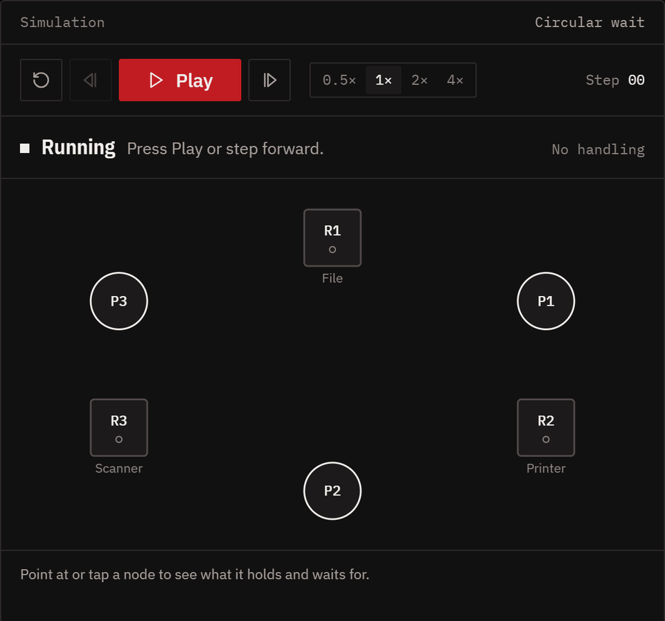
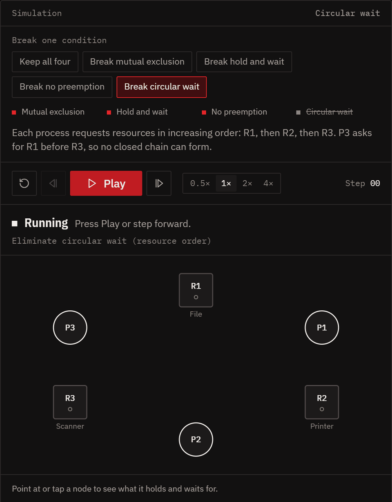
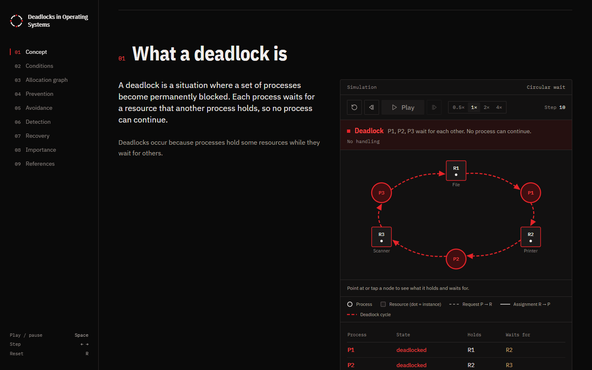
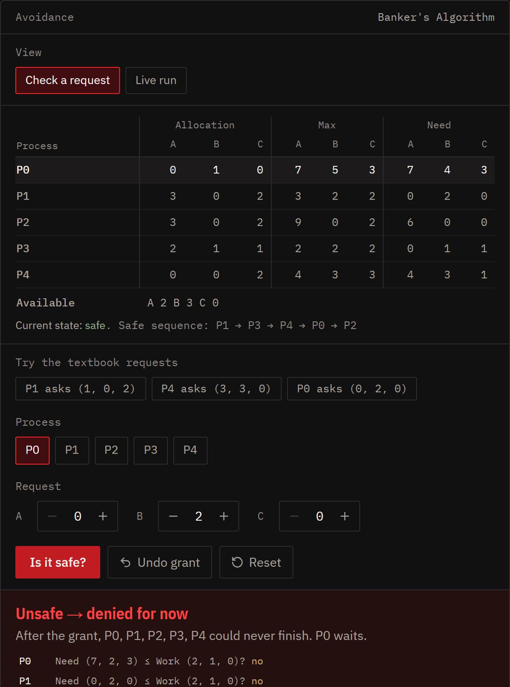
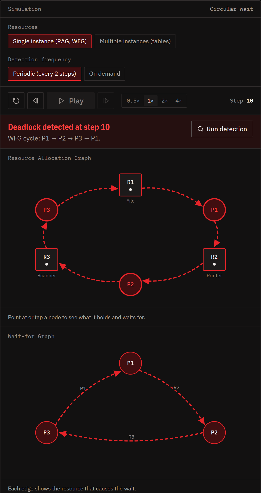
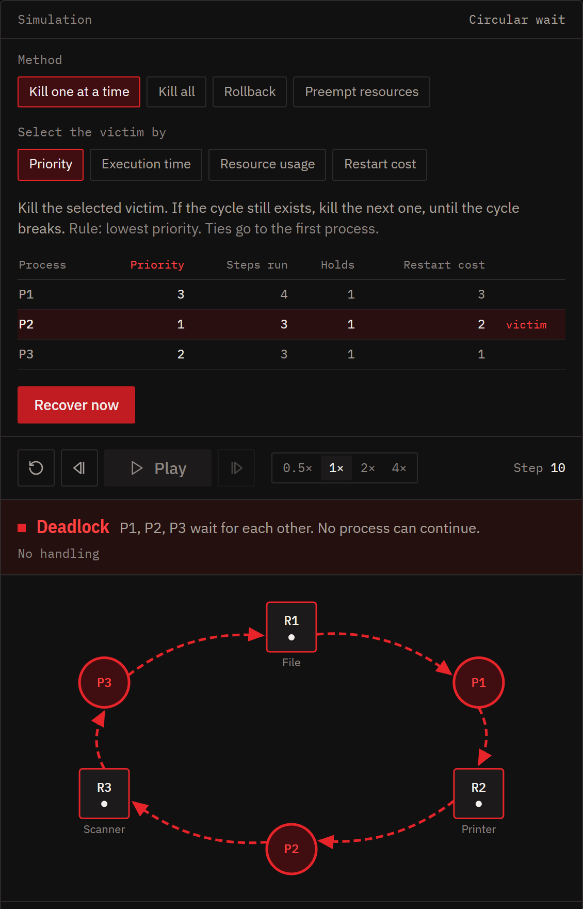
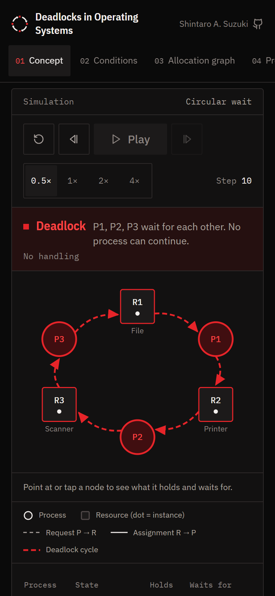

<h1 align="center">
  <picture>
    <source media="(prefers-color-scheme: dark)" srcset="docs/assets/logo-dark.svg">
    
  </picture>
</h1>

<p align="center">
  <a href="LICENSE"></a>
  
  
  
  
  
  
  
</p>

<p align="center">
  <a href="#overview">Overview</a> · <a href="#preview">Preview</a> · <a href="#features">Features</a> · <a href="#setup-instructions">Setup</a> · <a href="#how-to-use">How to Use</a> · <a href="#keyboard-shortcuts">Shortcuts</a> · <a href="#license">License</a>
</p>

<p align="center"><em>An educational web application that shows how deadlocks occur in operating systems and how the system handles them. Each chapter pairs the theory with a live simulation.</em></p>

## About This Project

This project was developed for educational purposes as a personal project and initiative for my BSIT 2nd Year course, COMP 007 — Operating Systems, at university. The tool demonstrates and simulates how deadlocks work in operating systems, made for and used during our group presentation and classroom learning.

### Development Methodology

This project was developed through Intent-Driven Software Development and Generative AI-assisted development as part of the engineering and development process. The implementation follows a phase-gated approach to ensure systematic development and verification at each stage.

## Overview

The content and scope follow the group presentation "Deadlocks in Operating Systems: Concepts, Handling, and Recovery". The app has nine chapters in the same order as the presentation. Seven chapters have a live demo.

| # | Chapter | Live demo |
|---|---|---|
| 01 | Concept | Three processes run into a circular wait. |
| 02 | Conditions | Break one of the four conditions and run the same processes again. |
| 03 | Resource Allocation Graph | Compare a cycle with single-instance resources (deadlock) and with multiple-instance resources (no deadlock). |
| 04 | Prevention | Apply each prevention strategy and see how it changes the process scripts. |
| 05 | Avoidance | Ask the Banker's Algorithm: "If I give this resource, will the system remain safe?" |
| 06 | Detection | Run periodic or on-demand detection on the RAG and the Wait-for Graph. Step through the multiple-instance algorithm. |
| 07 | Recovery | Kill a process, roll it back, or preempt its resources. Select the victim by priority, execution time, resource usage, or restart cost. |
| 08 | Importance | Text only. |
| 09 | References | Text only. |

## Preview

These images come from the running app.

<p align="center">
  
</p>
<p align="center"><em>Chapter 01. Three processes step into a circular wait.</em></p>

<p align="center">
  
</p>
<p align="center"><em>Chapter 02. Break circular wait, and the same processes finish.</em></p>

<p align="center">
  
</p>
<p align="center"><em>Desktop view. The chapter list stays on the left. Each chapter pairs the text with a demo.</em></p>

<table>
  <tr>
    <td width="50%" valign="top">
      
      <p><em>Chapter 05. The Banker's Algorithm denies an unsafe request and shows each check.</em></p>
    </td>
    <td width="50%" valign="top">
      
      <p><em>Chapter 06. Detection finds the cycle in the RAG and in the Wait-for Graph.</em></p>
    </td>
  </tr>
  <tr>
    <td width="50%" valign="top">
      
      <p><em>Chapter 07. Select a victim by priority, execution time, resource usage, or restart cost.</em></p>
    </td>
    <td width="50%" valign="top">
      
      <p><em>Phone view. The chapter list moves to a bar at the top.</em></p>
    </td>
  </tr>
</table>

## Features

- A simulation engine that runs process scripts step by step (request, release, work).
- Seven ways to handle deadlock: none, four prevention strategies (with two variants for hold and wait), and the Banker's Algorithm.
- Three recovery methods with victim selection.
- A Resource Allocation Graph. Processes are circles. Resources are squares with one dot per instance. Request edges are dashed. Assignment edges are solid. A deadlock cycle is red.
- A Wait-for Graph that shows which resource causes each wait.
- Step back, play, pause, and four speeds (0.5×, 1×, 2×, 4×).
- Keyboard shortcuts for the chapter that is on screen.
- A black-red, dark-only theme that is easy to read on a projector.
- Fonts that load from the app itself, so the app works without an internet connection.
- Layouts for desktop, tablet, and mobile.

## Setup Instructions

1. Install the dependencies.
   ```bash
   npm install
   ```

2. Start the development server.
   ```bash
   npm run dev
   ```

3. Open the URL that the terminal shows.

## Build for Production

Run this command to make a production build.

```bash
npm run build
```

The build output goes to the `dist` directory.

## Run the Checks

Run the unit tests.

```bash
npm test
```

Run the linter.

```bash
npm run lint
```

## How to Use

1. Use the chapter list on the left (desktop) or at the top (mobile and tablet) to go to a chapter.
2. Read the text. Then use the demo next to it.
3. Use Play, Step, and Step back to move through the simulation.
4. Change the options above the controls (for example, the prevention strategy) to compare results.
5. Point at or tap a node in the graph to see what it holds and waits for.

## Keyboard Shortcuts

The shortcuts control the demo in the chapter that is on screen.

- Space: Play or pause
- Arrow Right: Step forward
- Arrow Left: Step back
- R: Reset

## Educational Concepts

### Four Conditions for Deadlock
- **Mutual exclusion**: At least one resource cannot be shared.
- **Hold and wait**: A process holds a resource and waits for more.
- **No preemption**: The system cannot take a resource away by force.
- **Circular wait**: Each process in a closed chain holds a resource that the next process needs.

If one condition is broken, deadlock cannot occur.

### Deadlock Handling Approaches
- **Prevention**: Break one of the four conditions.
- **Avoidance**: Check each request and grant it only if the system stays safe (Banker's Algorithm).
- **Detection**: Find a cycle in the RAG or WFG (single instance), or run the table algorithm (multiple instances).
- **Recovery**: Kill a process, roll it back to a checkpoint, or preempt its resources.

### Graphs
- **Resource Allocation Graph (RAG)**: Request edge Pi → Rj. Assignment edge Rj → Pi. With single-instance resources, a cycle means deadlock. With multiple-instance resources, a cycle is necessary but not sufficient.
- **Wait-for Graph (WFG)**: The RAG without resource nodes. Pi → Pj means Pi waits for a resource that Pj holds.

## Project Structure

```
src/
├── content/            # All reading text (from the presentation) and demo text
├── core/               # Pure logic, no UI
│   ├── model.ts        # State model and types
│   ├── rag.ts          # Resource Allocation Graph and Wait-for Graph
│   ├── cycle.ts        # Cycle search in path order
│   ├── detection.ts    # Multiple-instance detection
│   ├── banker.ts       # Banker's safety check and request check
│   ├── reduction.ts    # Shared "find a process that can finish" loop
│   ├── engine.ts       # Step engine
│   ├── policies.ts     # Prevention and avoidance rules
│   └── recovery.ts     # Terminate, rollback, preempt
├── scenarios/          # Scenario data (circular wait, printer and scanner, Banker's examples)
├── hooks/              # useSimulation (autoplay, step back, keys) and helpers
├── components/
│   ├── shell/          # Page layout, chapter rail, text blocks
│   ├── sim/            # Controls, status, tables, step log
│   ├── graph/          # RAG and WFG drawings
│   └── ui/             # Panel, option group, stepper
├── chapters/           # One demo per chapter (loaded on demand)
└── App.tsx
```

## Tech Stack

- React 18 with TypeScript
- Vite
- Tailwind CSS with design tokens in CSS variables
- Framer Motion
- Lucide React icons
- IBM Plex Sans, Sans Condensed, and Mono (Fontsource)
- Vitest

## Implementation Phases

The project uses a phase-gated development approach.

- **Phases 1–9**: Setup, first simulation engine, base UI, scenarios, and documentation
- **Phases 10–16**: Panels for the conditions, RAG and WFG, prevention, Banker's Algorithm, detection, recovery, and references
- **Phase 17**: Black-red brand, design tokens, fonts, and lint setup
- **Phase 18**: New core algorithms (RAG, WFG, cycle search, detection, Banker's) with tests
- **Phase 19**: Step engine, prevention and avoidance policies, and recovery
- **Phase 20**: Chapter layout with the presentation content
- **Phase 21**: Graph and demos for chapters 01–04
- **Phase 22**: Demos for avoidance, detection, and recovery
- **Phase 23**: Accessibility, motion, and documentation

## License

This project is licensed under the MIT License. See the LICENSE file for details.
